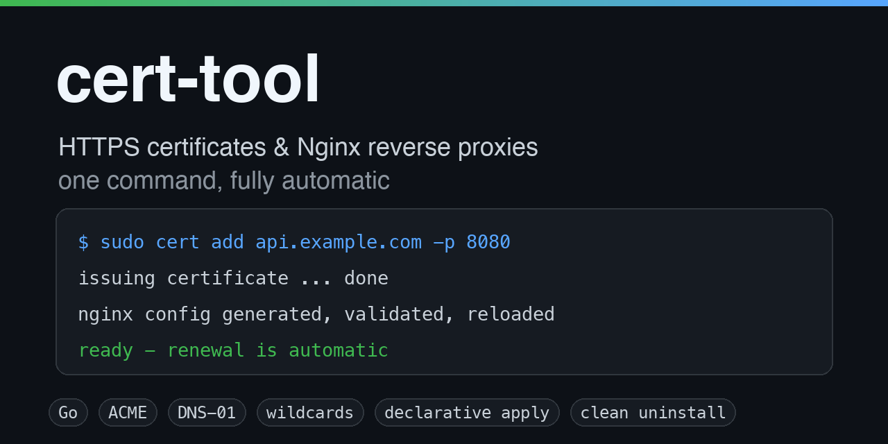
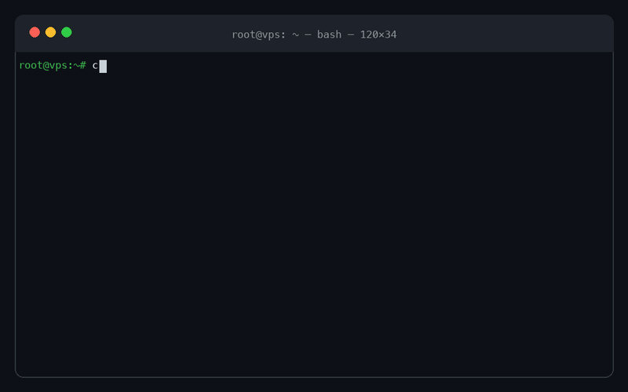

# cert-tool

> 一条命令完成 HTTPS 证书申请与生产级 Nginx 反向代理配置：自动续期、泛域名证书、声明式管理。

[](https://github.com/Rson9/cert-tool/actions/workflows/ci.yml)
[](https://github.com/Rson9/cert-tool/releases)
[](LICENSE)

[English](README.md) | **简体中文**

<p align="center"></p>

<p align="center"></p>
<p align="center"><sub>演示 — 安装 · 初始化 · 一条命令开通 HTTPS · 泛域名 + 声明式 apply · 无侵入卸载（约 1 分钟，<a href="docs/demo.mp4">MP4</a>）</sub></p>

`cert` 是一个单文件 CLI 工具，面向 Linux 服务器（VPS、家庭实验室、自建服务等场景）。它**内置 ACME 客户端**，把整套 HTTPS 工作流自动化：[Let's Encrypt](https://letsencrypt.org) 证书申请（HTTP-01 与 DNS-01）、Nginx 反向代理生成、WebSocket 支持、无人值守续期，以及声明式、幂等的站点管理。

---

## ✨ 核心特性

- **内置 ACME 客户端** —— 无需安装任何外部依赖。基于 [lego](https://github.com/go-acme/lego) 实现，ACME 账户密钥与证书全部落在本地磁盘，其余全自动。
- **HTTP-01 与 DNS-01 双挑战模式** —— HTTP-01 使用共享 Webroot，全程不影响运行中的站点；DNS-01 支持**泛域名证书**（`*.example.com`），原生集成 Cloudflare、阿里云、DNSPod、腾讯云、DuckDNS、Route 53，并内置引导式 `manual` 模式适配任意 DNS 服务商。
- **声明式管理** —— 在 `cert-tool.yml` 中描述全部站点，执行 `cert apply`：并发开通、幂等重跑、`--dry-run` 预览、`--prune` 仅清理本工具管理的站点。
- **真正的自动续期** —— 每日 `cert renew` 任务（以 `/etc/cron.d/cert-tool` 安装），到期前 30 天自动换发并重载 Nginx，幂等且随时可安全执行。
- **生产级 Nginx 配置** —— HTTP 强跳 HTTPS、仅启用 TLS 1.2/1.3、现代加密套件、WebSocket 升级支持、合理超时，并自动适配已安装的 Nginx 版本。
- **全发行版自适应** —— 自动识别 `apt` / `dnf` / `yum` / `apk` / `pacman`，支持 `systemd` 与 `OpenRC`。
- **安全设计** —— 所有输入在进入文件系统、Nginx 配置或 shell 前严格校验；只修改带托管标记的文件；私钥权限 `600`。
- **智能诊断** —— `cert list` 展示反代上游与证书到期倒计时；`cert test` 一键验证 Nginx 语法、公网 HTTPS 与后端服务。

## 📋 前置条件

- 一台具有公网 IP 的 Linux 服务器（macOS 二进制仅用于开发调试）。
- HTTP-01：域名 DNS **A/AAAA 记录指向该服务器**，且 **80、443 端口**可从公网访问。
- DNS-01 / 泛域名：受支持 DNS 服务商的 API 凭证（或使用 `manual` 模式交互完成）。
- root 或 `sudo` 权限（系统管理命令会自动通过 `sudo` 重新执行，每次运行只需授权一次）。
- 依赖软件（由 `cert init` 自动安装）：`nginx`、`curl`、`openssl`、`cron`。

## 🚀 安装

### 一行命令安装（推荐）

```bash
curl -fsSL https://raw.githubusercontent.com/Rson9/cert-tool/main/install.sh | sudo bash
```

安装指定版本或自定义目录：

```bash
curl -fsSL https://raw.githubusercontent.com/Rson9/cert-tool/main/install.sh | sudo bash -s -- --version v1.0.0
curl -fsSL https://raw.githubusercontent.com/Rson9/cert-tool/main/install.sh | sudo bash -s -- --install-dir /opt/bin
```

安装脚本会自动识别操作系统与 CPU 架构、下载对应的发布二进制、校验 SHA-256，然后安装到 `/usr/local/bin/cert`。

> 使用镜像或自建发布仓库？设置 `CERT_TOOL_BASE_URL=https://your.mirror/releases`（全部选项见 [install.sh](install.sh)）。

### 手动安装

从 [Releases 页面](https://github.com/Rson9/cert-tool/releases) 下载对应平台的二进制：

```bash
sudo install -m 755 cert-linux-amd64 /usr/local/bin/cert
```

### 从源码构建

```bash
git clone https://github.com/Rson9/cert-tool.git
cd cert-tool
make build          # 或 make release 构建全部平台到 dist/
sudo make install
```

## 🏁 快速上手

只需两条命令：

```bash
# 1. 初始化服务器（安装 nginx、创建共享 ACME 验证端点与续期定时任务）
sudo cert init

# 2. 添加站点：api.example.com -> http://127.0.0.1:8080
sudo cert add api.example.com -p 8080
```

用 `curl -I https://api.example.com` 验证即可 —— 完成，证书会自动续期。

可选：设置默认域名与邮箱，之后就能用短域名、并收到到期提醒：

```bash
sudo cert init -d example.com -e admin@example.com   # 之后：cert add api -p 8080
```

以下内容（泛域名、DNS-01、声明式管理）均为**可选进阶功能** —— 绝大多数用户只需要上面两条命令。

如果要批量管理多个站点，也可以用声明式方式：

```bash
cat > cert-tool.yml <<'EOF'
email: admin@example.com
base_domain: example.com
default_port: 8080
sites:
  - domain: api
  - domain: "*.example.com"
    dns_provider: cloudflare
EOF

sudo cert apply -f cert-tool.yml
```

## 📖 使用说明

### 命令式：添加与移除站点

```bash
cert add api                       # api.example.com -> http://127.0.0.1:8080（HTTP-01）
cert add web -p 3000               # web.example.com -> http://127.0.0.1:3000
cert add foo.bar.com -p 5000       # 独立域名           -> http://127.0.0.1:5000
cert add node -u http://10.0.0.2   # 代理至内网其他机器
cert add api -d other.com          # api.other.com，覆盖基础域名
cert add api --san www.example.com # 一张证书同时覆盖两个域名
cert add '*.example.com' --dns cloudflare   # 泛域名证书（DNS-01）
cert add api --staging             # 使用 Let's Encrypt 测试环境签发
cert remove api                    # 移除站点
```

| 参数 | 说明 |
| --- | --- |
| `-p, --port <port>` | 本地上游端口（默认使用配置中的 `default_port`） |
| `-u, --upstream <url>` | 完整上游：`host[:port]`、`http(s)://host[:port][/path]` 或 `unix:/path.sock` |
| `-d, --domain <domain>` | 短子域名所对应的基础域名 |
| `--dns <provider>` | 使用指定服务商的 DNS-01（泛域名必填） |
| `--san <domain>` | 为证书添加一个备用域名（SAN） |
| `--staging` | 使用 Let's Encrypt 测试环境（避免消耗生产配额） |

### 声明式：`cert apply`（可选 —— 适合一次管理多个站点）

`cert-tool.yml`（YAML 或 JSON）描述服务器的期望状态：

```yaml
email: admin@example.com      # ACME 账户邮箱
base_domain: example.com      # 短域名自动展开的基础域名
default_port: 8080            # 默认上游端口
dns_provider: cloudflare      # 可选，所有站点的默认 DNS 服务商
staging: false                # 可选，使用 LE 测试环境
sites:
  - domain: api               # -> api.example.com
  - domain: foo.bar.com
    upstream: http://10.0.0.2:5000
  - domain: "*.example.com"
    dns_provider: cloudflare
  - domain: app.example.com
    upstream: unix:/run/app.sock
    sans: [www.example.com]
```

```bash
cert apply --dry-run                 # 只预览计划，不做任何修改
cert apply                           # 创建/更新站点（3 个 worker 并发）
cert apply --prune                   # 同时删除 manifest 中已不存在的托管站点
cert apply --workers 5 -f other.yml  # 自定义并发数与 manifest 路径
```

安全保证：

- **幂等** —— manifest 未变化时重复执行 `apply` 不会有任何动作。
- **非破坏性** —— 只会修改/删除带 `# Managed by cert-tool` 标记的 Nginx 配置，你自己的配置绝不会被动。
- **并发** —— 多站点证书签发并行执行（有界 worker 池，避免触发 ACME 限流）。

### 其他命令

| 命令 | 说明 |
| --- | --- |
| `cert init [flags]` | 初始化服务器：依赖、共享 ACME 验证端点、续期定时任务 |
| `cert renew [--days N] [--force]` | 续期 N 天内到期的证书（默认 30 天） |
| `cert list` | 列出站点、反代上游与证书到期倒计时 |
| `cert test <domain>` | 诊断 Nginx 语法、公网 HTTPS 与后端服务 |
| `cert remove <domain>` | 移除站点的 Nginx 配置、证书与元数据 |
| `cert check` | 检查依赖、权限与当前配置 |
| `cert dns` | 列出支持的 DNS-01 服务商及所需凭证 |
| `cert config show\|path\|set` | 查看或修改全局配置 |
| `cert install` | 将当前二进制安装到 `/usr/local/bin/cert` |
| `cert update [--check]` | 自更新 cert 到最新发布版本 |
| `cert version` | 打印版本号 |

### 全局配置

```bash
cert config set domain example.com     # 短子域名的基础域名
cert config set port 8080              # 默认上游端口
cert config set email admin@example.com
cert config show                       # 打印当前生效配置
cert config path                       # 打印配置文件路径
```

配置文件位于 `/etc/cert-tool/config.json`（非 root 使用 `~/.config/cert-tool/config.json`，可用环境变量 `CERT_CONFIG` 覆盖）。

## 🌐 泛域名证书与 DNS-01（可选）

泛域名证书只能通过 DNS-01 签发。选择一个服务商（`cert dns` 查看完整列表）并导出对应凭证：

```bash
export CLOUDFLARE_DNS_API_TOKEN=...
sudo --preserve-env=CLOUDFLARE_DNS_API_TOKEN cert add '*.example.com' --dns cloudflare
```

| 服务商 | 所需凭证（环境变量） |
| --- | --- |
| `cloudflare` | `CLOUDFLARE_DNS_API_TOKEN` |
| `alidns`（阿里云） | `ALICLOUD_ACCESS_KEY`、`ALICLOUD_SECRET_KEY` |
| `dnspod`（DNSPod） | `DNSPOD_API_KEY` |
| `tencentcloud`（腾讯云） | `TENCENTCLOUD_SECRET_ID`、`TENCENTCLOUD_SECRET_KEY` |
| `duckdns` | `DUCKDNS_TOKEN` |
| `route53`（AWS） | `AWS_ACCESS_KEY_ID`、`AWS_SECRET_ACCESS_KEY` |
| `manual` | 无需凭证 —— 打印 TXT 记录并等待确认（交互式） |

> `manual` 模式适配**任意** DNS 服务商，但需要交互操作，只适合首次签发；无人值守续期请改用带 API 的服务商，或手动执行 `cert renew --force`。

## ⚙️ 工作原理（想了解内部机制时再看）

1. **ACME 账户** —— 首次签发时在 `/etc/cert-tool/account/account.key` 生成 ECDSA 账户密钥并注册到 Let's Encrypt。**该密钥即你的账户，请务必备份。**
2. **挑战验证** —— HTTP-01 通过共享 Nginx 端点（`00-acme-challenge.conf`）从 `/var/www/cert-challenge` 提供 `/.well-known/acme-challenge/`，全程不需要占用额外端口、不影响现有站点；DNS-01 通过服务商 API 创建 TXT 记录（泛域名必需）。
3. **签发证书** —— 内置 ACME 客户端（lego）完成下单，返回证书（默认 ECC P-256，含完整证书链）。
4. **安装证书** —— 证书与私钥写入 `/etc/nginx/ssl/`（私钥权限 `600`），并保存 `.meta.json` 元数据（挑战类型、服务商、SAN），供续期时复现同样的签发方式。
5. **生成反代** —— 在 `/etc/nginx/conf.d/` 生成站点配置，先 `nginx -t` 校验再重载。模板自动适配 Nginx 版本（如 ≥ 1.25.1 使用 `http2 on;`）。
6. **自动续期** —— `/etc/cron.d/cert-tool` 每日执行 `cert renew --quiet`：30 天内到期的证书并发换发，最后统一重载一次 Nginx。其余证书跳过，因此该任务随时执行都安全。

工具写入的文件一览：

| 路径 | 用途 |
| --- | --- |
| `/etc/nginx/conf.d/<domain>.conf` | 站点 Nginx 配置（带 `# Managed by cert-tool` 标记） |
| `/etc/nginx/conf.d/00-acme-challenge.conf` | 共享 ACME HTTP-01 验证端点 |
| `/etc/nginx/conf.d/00-cert-tool-map.conf` | 共享 WebSocket `Connection` 头映射 |
| `/etc/nginx/ssl/<domain>.pem` / `.key` | 证书 / 私钥（权限 `600`） |
| `/etc/nginx/ssl/<domain>.meta.json` | 签发元数据（续期使用） |
| `/etc/cert-tool/account/account.key` | ACME 账户密钥（**请备份**） |
| `/etc/cert-tool/config.json` | 工具配置 |
| `/etc/cron.d/cert-tool` | 每日续期任务 |

> 与 80 端口冲突的发行版默认站点会被**移走备份，绝不会删除**（`default.conf` → `default.conf.bak`，`sites-enabled/default` → `sites-enabled/default.disabled-by-cert-tool`）。

## 🤝 与已有 Nginx 共存

本工具**与你的 Nginx 共存，绝不接管**。你自己的 server 块、模块、全局配置永远不会被改写；工具只添加自己的文件（带 `# Managed by cert-tool` 标记），卸载时也只删这些文件。

在开通站点前，工具会解析你的完整配置（`nginx -T`）并自适应：

| 场景 | 行为 |
| --- | --- |
| 已装 Nginx、有自己的站点 | 不重装、不卸载你的 Nginx，只新增工具自己的文件 |
| 你自定义了 80 端口的 `default_server` | 共享 ACME 验证端点**自动退让**，不加 `default_server`（重复会导致 Nginx 无法启动） |
| 你的 `nginx.conf` 没有 include `conf.d/*.conf` | 明确报错并告诉你怎么加，而不是静默失败 |
| 某个外来 server 块已服务该域名 | **签发前直接拒绝**（HTTP-01 验证会打到那个块上失败）：禁用它或改用 DNS-01 |
| 发行版默认欢迎页占 80 端口 | 挪走备份，**卸载时还原** |

一个需要知道的点：如果某个域名的流量已经由外来 server 块处理，这张证书只能用 DNS-01（`--dns <provider>`）申请 —— 因为 HTTP-01 验证请求会被那个块响应，这是 HTTP-01 协议本身的特性，不是工具的限制。

## 🧹 卸载 —— 完整还原到安装前的状态

```bash
# 一行命令卸载（二进制丢失时会自动下载对应版本来执行卸载逻辑）
curl -fsSL https://raw.githubusercontent.com/Rson9/cert-tool/main/uninstall.sh | sudo bash

# 或者二进制还在时直接用
sudo cert uninstall --dry-run    # 先预览卸载计划
sudo cert uninstall              # 确认执行
```

卸载是**无侵入式设计**。工具在安装时会把所有对既有状态的改动记录成快照（`/etc/cert-tool/state.json`），卸载时精确逆操作 —— 不多删、不少删：

| 动作 | 说明 |
| --- | --- |
| 还原 | 安装时挪走的发行版默认站点文件会被移回原位 |
| 删除 | 托管站点配置、证书、共享 ACME 验证端点与 WebSocket 映射 |
| 删除 | 续期定时任务、续期日志、工具配置与 ACME 账户 |
| 还原 | 如果安装时启动/开机启用了 nginx，卸载时会停用/关闭开机启动 |
| 删除 | `cert init` 安装的、且**安装前本就不存在**的软件包 |
| 删除 | 工具二进制本身 |

可选参数：

- `--keep-sites` —— 保留 Nginx 配置与证书，只移除工具本体（注意续期会停止，需手动续期或保留 cron）
- `--keep-packages` —— 保留 `cert init` 安装的软件包
- `--dry-run` —— 只展示计划，不做任何修改

计划之外的东西绝不触碰：你自己的 Nginx 配置、文件、软件包都保持原样。

## ❓ 常见问题与排障

**`cert add` 提示 "certificate issuance failed"**
- HTTP-01：域名 DNS A 记录必须解析到本服务器（`dig +short api.example.com`），80 端口可从公网访问，且 CDN 代理（如 Cloudflare 橙色云）需暂时关闭。
- DNS-01：检查服务商凭证（`cert dns` 列出了每个服务商所需配置），注意 TXT 记录传播延迟。
- 频率限制：Let's Encrypt 每个注册域名每周最多约 50 张证书。测试请用 `--staging`，详见[官方说明](https://letsencrypt.org/docs/rate-limits/)。

**如何在不消耗生产配额的情况下测试？** `cert add api --staging` 签发测试证书（浏览器不受信任），流程完全一致；就绪后去掉 `--staging` 重新签发即可。

**如何升级工具本身？** `sudo cert update`（只想看看有没有新版：`cert update --check`）。它会下载对应平台的最新二进制、校验 SHA-256、先试运行再原子替换，证书与自动续期不受任何影响。

**如何验证自动续期是否正常？**
```bash
sudo cert renew --force      # 立即强制执行一次续期
cat /etc/cron.d/cert-tool    # 查看每日任务
tail /var/log/cert-tool-renew.log
```

**证书在哪里？** `/etc/nginx/ssl/<domain>.pem`（完整证书链）与 `.key`（私钥）。泛域名文件名以 `_wildcard` 开头。

**可以更换 CA 吗？** 引擎使用标准 ACME 协议，可修改 `caProduction` 指向其他 CA 目录，或提交 issue 讨论配置化支持。

**Nginx 提示 `listen ... http2` 警告。** 工具会自动检测 Nginx 版本：≥ 1.25.1 使用 `http2 on;`，旧版本使用传统写法。

**如何彻底移除这个工具？** 见上文[卸载](#-卸载--完整还原到安装前的状态)章节：`sudo cert uninstall` 会把服务器完整还原到安装前的状态。

## 🔐 安全说明

- 系统管理命令统一通过 `sudo` 重新执行，权限处理集中、可审计。
- 域名与上游地址输入都会严格校验，杜绝进入文件系统、Nginx 配置或 shell 的注入风险。
- 生成文件权限：Nginx 配置 `644`、私钥 `600`、账户密钥 `600`。
- `apply` 绝不会触碰缺少 `# Managed by cert-tool` 标记的 Nginx 配置。
- `uninstall` 只逆向恢复安装时记录的改动，执行前会展示完整计划。
- `install.sh` 在发布方提供 `checksums.txt` 时会校验下载二进制的 SHA-256。

## 🤝 参与贡献

欢迎提交 Issue 与 Pull Request！

```bash
git clone https://github.com/Rson9/cert-tool.git
cd cert-tool
make vet && make test
make release   # 确认全部发布二进制可正常构建
```

修改行为时请同步更新命令行输出与中英文文档。

## 📄 许可证

[MIT](LICENSE)

## 🙏 致谢

- [lego](https://github.com/go-acme/lego) —— 完成核心工作的 ACME 客户端库。
- [Let's Encrypt](https://letsencrypt.org) —— 让所有人都能用上免费证书。
- [Nginx](https://nginx.org/) —— 本工具所配置的 Web 服务器。
